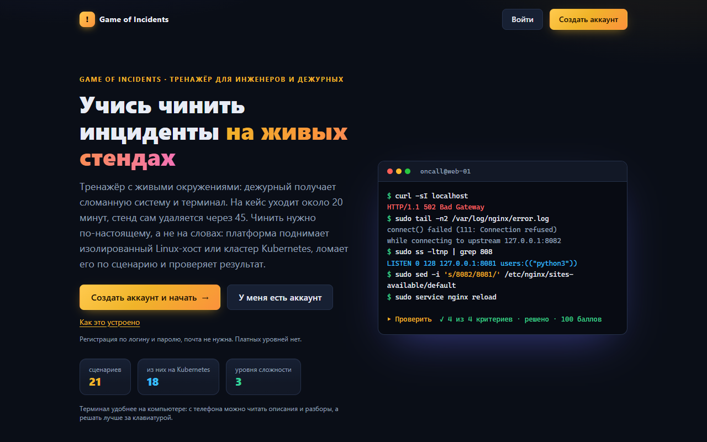

# Game of Incidents

English: [README.en.md](README.en.md) · Лицензии: код [Apache-2.0](LICENSE), сценарии и документация [CC BY 4.0](LICENSE-CONTENT.md) · [Участие](CONTRIBUTING.md) · [Безопасность](SECURITY.md)

Game of Incidents — браузерная платформа для тренировки инцидентов: заходишь, открываешь сценарий, нажимаешь «Запустить», получаешь терминал в изолированное, намеренно сломанное окружение (Linux‑хост или собственный кластер Kubernetes), чинишь и жмёшь «Проверить». Грейдер смотрит на результат, а не на способ; после решения открывается разбор.

**Демо:** https://game.sresh.ru — публичный экземпляр сопровождающего, регистрация открыта (логин и пароль, без почты). Учётки без активности 7 дней отключаются, одновременно живут до 20 сессий (из них до 6 Kubernetes), на одного пользователя одна активная сессия.

**Поставить у себя** (чистый Debian 13 или Ubuntu 24.04, от 2 CPU / 8 ГБ / 40 ГБ свободного места, root по ssh-ключу; домен необязателен):

```bash
git clone https://github.com/fadeinflames/game-of-incidents.git && cd game-of-incidents
bash scripts/provision/provision.sh --host 203.0.113.10 --domain game.example.com --dry-run   # показать план
bash scripts/provision/provision.sh --host 203.0.113.10 --domain game.example.com             # поставить
```

Подробности, установка без домена (по IP), обновление и эксплуатация — в [руководстве](docs/runbook-prod-install.md).

Наследник текстовой игры [wom-games](https://github.com/fadeinflames/wom-games): её 18 кейсов перенесены в живые окружения, к ним добавлены Linux‑сценарии и «Фантомная сеть». Всего в каталоге 22 сценария (3 для Linux‑хоста, 19 для Kubernetes на kind); у пяти junior‑кейсов есть учебная копия с этапами помощи. Стенд запускается только со страницы сценария `/scenarios/<slug>`.



## Документация

| Что | Где |
|---|---|
| Архитектура | [docs/architecture-overview.md](docs/architecture-overview.md) |
| Решения (ADR) | [docs/adr/](docs/adr/README.md) |
| Модель угроз и статусы рисков | [docs/threat-model.md](docs/threat-model.md) |
| Установка и эксплуатация прода, инцидент в песочнице | [docs/runbook-prod-install.md](docs/runbook-prod-install.md) |
| Поставить платформу на голый хост Debian 13 или Ubuntu 24.04 одной командой (`scripts/provision/provision.sh`, можно без домена, по IP) | [Быстрый путь](docs/runbook-prod-install.md#быстрый-путь-рекомендуется) |
| Сторонние компоненты и авторство | [NOTICE](NOTICE) |
| Лицензии зависимостей | [docs/legal/third-party-licenses.md](docs/legal/third-party-licenses.md) |

Kubernetes, Docker, PostgreSQL, nginx и другие названия продуктов принадлежат их владельцам; проект с ними не связан.

Документация основная на русском, английские версии основных документов: [README.en.md](README.en.md), [docs/install.en.md](docs/install.en.md), [CONTRIBUTING.en.md](CONTRIBUTING.en.md), [SECURITY.en.md](SECURITY.en.md). 

## Раскладка репозитория

```
apps/web/               Next.js 16 (App Router, React 19, Tailwind 4): вход и регистрация, каталог, колесо, страница сценария и сессии (xterm.js), история, кабинет автора, админка, /api/health
services/orchestrator/  Node 22 + TypeScript: сессии и квоты, очередь подъёма кластеров, reconciler, шлюз терминала (WebSocket), грейдер, сборка и регресс заявок авторов, защита по диску
packages/db/            Prisma 6: схема, миграции, сид (загружает scenarios/*/scenario.yaml)
packages/runtime/       RuntimeProvider: Docker (харднутые песочницы), kind (кластер на сессию), fake для тестов
packages/scenario/      формат сценария v2 (zod), загрузчик, линтер, распаковка zip, регресс, CLI `wom`
scenarios/<slug>/       scenario.yaml, brief.md, debrief.md, guide.md (учебные), image/ или k8s/, break.sh, check.sh, solve.sh
images/                 образы платформы: tools (терминал кластерной сессии), egress-guard, sysv-shims
deploy/                 Caddyfile, prod‑overlay compose, systemd‑юниты, backup.sh, healthcheck.sh
scripts/                deploy.sh, prepull-images.ts
schemas/                JSON Schema формата v2
agent-skill/            инструкция для LLM, которая собирает папку сценария из описания инцидента
docs/                   установка и эксплуатация, архитектура, ADR, модель угроз, лицензии зависимостей
NOTICE                  сторонние компоненты и авторство
```

## Локальная разработка

Нужны Linux, Node 22, Docker и GNU Make; для Kubernetes-сценариев ещё `kind` в `PATH` (версия в `services/orchestrator/Dockerfile`, `ARG KIND_VERSION`) и образ терминала `wom-tools:dev` (его собирает `make scenarios`). PostgreSQL ставить не нужно: он поднимается контейнером (`make db-up`). Песочницы создаются на демоне, к которому подключён оркестратор; для разработки нужен отдельный rootless‑демон Docker (так же устроен прод). Сокет демона задаётся в `.env` (`DOCKER_SOCKET_PATH`), а для CLI и `make` — переменной `DOCKER_HOST`.

```bash
cp .env.example .env     # впиши INTERNAL_TOKEN (openssl rand -hex 32) и DOCKER_SOCKET_PATH своего демона; остальное в .env.example закомментировано, дефолты рабочие
export DOCKER_HOST=unix:///run/user/$(id -u)/docker.sock   # сокет твоего rootless‑демона
make install             # npm workspaces
make scenarios           # образы платформы и сценариев в демон песочниц
make db-up               # PostgreSQL в контейнере (127.0.0.1:5433)
make db-migrate seed     # схема, сценарии, демо‑пользователь (только для разработки)
make dev-orchestrator    # терминал 1, порт 3080
make dev-web             # терминал 2, порт 3000
```

Открой http://localhost:3000 и войди: логин `demo`, пароль `demo1234` (или значение `SEED_DEMO_PASSWORD` из `.env`, если задал его до `make seed`). Открой «Nginx отдаёт 502» в каталоге, нажми **Запустить**, дождись терминала, диагностируй, чини, нажми **Проверить**. Обычную учётку можно завести и через `/register`.

Весь стек в контейнерах: `make up` (db, orchestrator, web, egress-guard). Он рассчитан на rootless‑демон под Linux; оркестратор не стартует, пока `egress-guard` не подтвердит правила (`DOCKER_NETNS_FILE` в `.env.example`). Сид внутри контейнера оркестратора не создаёт `demo` без `SEED_DEMO_PASSWORD`; администратора можно задать через `ADMIN_USERNAME`, `ADMIN_EMAIL`, `ADMIN_PASSWORD` в `.env`. **`make seed` создаёт администратора `demo` с паролем по умолчанию: на проде его не запускать** (на хосте, где в `.env` заданы `COMPOSE_FILE` прод‑оверлея или `WOM_DOMAIN`, он откажется работать).

### Без Linux и Docker

Запустить саму платформу без Linux и rootless Docker нельзя: оркестратор при старте подключается к демону Docker, а режима «без песочниц» (например `RUNTIME=fake`) в коде нет. На Windows и macOS работай внутри Linux‑ВМ или WSL2 с rootless Docker. Если нужно только проверить свои изменения, Docker и PostgreSQL не требуются для юнит‑тестов: у `RuntimeProvider` есть заглушка `FakeRuntimeProvider` (`packages/runtime/src/fake.ts`), на ней работают тесты оркестратора.

```bash
npm install
npm -w @wom/web test
npm -w @wom/orchestrator run test:unit
npm -w @wom/runtime test
npm -w @wom/scenario test
```

## Проверка

```bash
make typecheck                       # tsc: orchestrator и web
npm -w @wom/runtime run typecheck && npm -w @wom/scenario run typecheck
npm -w @wom/runtime test             # юнит‑тесты runtime
npm -w @wom/scenario test            # архив, линтер, загрузчик, схема
make test                            # оркестратор: юнит и интеграционные (нужны DATABASE_URL и отдельная БД: тесты завершают активные сессии)
make lint                            # wom scenario lint scenarios/*/
make regress                         # wom scenario test scenarios/*/  (свежее → не решено, solve → решено, пробы харднинга)
make e2e                             # Playwright, критичный путь на запущенном стеке
```

## Деплой

Выделенный сервер, rootless Docker, Caddy с Let's Encrypt, домен из `WOM_DOMAIN` (или адрес по IP с самоподписанным сертификатом). Установка с нуля: `scripts/provision/provision.sh`; обновление: `provision.sh --update` или `./scripts/deploy.sh` на хосте. Подробности, сообщения скрипта, бэкапы, обновления и порядок действий при инциденте — в [руководстве](docs/runbook-prod-install.md). Запущенные песочницы не входят в compose и переживают рестарт оркестратора.

## Сценарии Kubernetes

`environment.kind: kubernetes` даёт сессии собственный кластер kind в отдельной сети `wk8s<id>`. Терминал инженера — харднутый tools‑контейнер (`images/tools`, `kubectl` и kubeconfig пользователя `oncall`), не нода kind. Манифесты из `manifests: ./k8s` применяются при старте, образы из `images` загружаются в ноды, `break/check/solve` выполняются в отдельном одноразовом runner‑контейнере с admin‑kubeconfig. Исходящие соединения кластера режет сервис `egress-guard`. Холодный старт обычного кластера около минуты, тяжёлые стенды (cert‑manager, Prometheus, ingress, четыре ноды) 1,5–3 минуты, тёплого пула нет. Образец: `scenarios/broken-probes`. Подробности и принятые отклонения — [ADR‑0008](docs/adr/0008-kubernetes-runtime.md).

## Свои сценарии

Любой зарегистрированный пользователь может загрузить папку сценария zip‑архивом в разделе **Мои сценарии**. Платформа сразу прогоняет линтер; модератор читает файлы заявки, запускает сборку и регресс и публикует ([ADR‑0009](docs/adr/0009-author-submissions.md)). Для генерации папки по описанию инцидента есть инструкция для LLM-агента: `agent-skill/wom-scenario-author/SKILL.md` (скачивается из кабинета автора). Агент выясняет у человека инцидент и инфраструктуру, пишет сценарий, проверяет его (`lint`, `build`, `test`, `run`) и загружает на платформу (`push`; администратору платформа сразу собирает образ, гоняет регресс, публикует и запускает сессию).

Сценарий — папка: `scenario.yaml` + `brief.md` + `debrief.md` + `image/Dockerfile` (или `k8s/`) + `break.sh` + `check.sh` + `solve.sh`; образец — `scenarios/nginx-502-upstream`, формат — [ADR‑0005](docs/adr/0005-scenario-format-v2.md). Скрипты платформы выполняются с `HOME=/nonexistent` и чистым `PATH`: `psql` в грейдере зови с `-X`, `curl` с `-q` первым аргументом, `break.sh` должен укладываться в 240 секунд.

```bash
npx wom scenario lint  scenarios/my-scenario
npx wom scenario build scenarios/my-scenario
npx wom scenario test  scenarios/my-scenario          # регресс и пробы харднинга
npx wom scenario run   scenarios/my-scenario          # сломанная песочница и интерактивный shell; --solve применяет эталон
npx wom scenario export scenarios/my-scenario -o my.json   # затем POST /api/import от админа или make seed на dev
npx wom scenario push   scenarios/my-scenario --url https://host [--check] [--publish] [--start]   # загрузить на платформу; логин и пароль в WOM_USER и WOM_PASSWORD
```

## Безопасность

Песочницы работают в rootless‑демоне Docker (root внутри — непривилегированный пользователь снаружи): корневая ФС только для чтения, `cap-drop ALL` с коротким allow‑list, лимиты ресурсов, без монтирований данных хоста и без Docker socket. Linux‑сессия живёт в отдельной сети `internal` без выхода наружу. В кластерной сессии игрок — cluster‑admin своего кластера, а нода kind — `privileged`‑контейнер в том же демоне, что и платформа: граница там слабее, исходящие соединения режет `egress-guard`, и этот риск для публичной аудитории остаётся открытым (R‑6). Скрипты грейдера и эталоны лежат в базе и не попадают на диск песочницы, терминал открывается по одноразовому токену владельца сессии. Подробности, статусы и решения владельца — [docs/threat-model.md](docs/threat-model.md). О найденной уязвимости сообщай приватно, как описано в [SECURITY.md](SECURITY.md); не открывай публичный issue.
