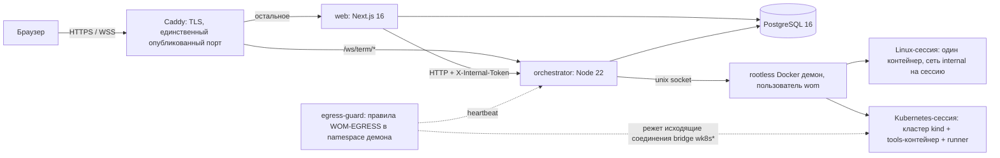
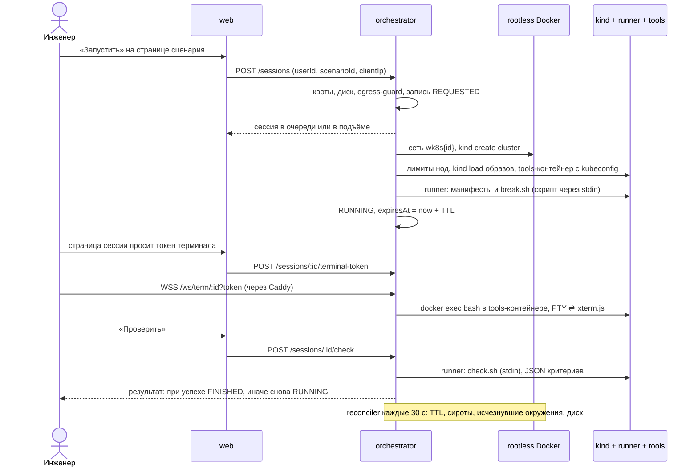

# Game of Incidents — архитектура

Это актуальное описание устройства платформы в варианте с открытой регистрацией; подробности и история решений — в `docs/adr/` (при расхождении верить дополнению с более поздней датой), безопасность — в `docs/threat-model.md`, эксплуатация — в `docs/runbook-prod-install.md`.

## Одной фразой

Game of Incidents — тренажёр инцидентов для инженеров: открыл страницу сценария, нажал «Запустить», за секунды (Linux) или минуту‑две (Kubernetes) получил намеренно сломанное окружение и терминал прямо в браузере, починил, платформа проверила результат и показала разбор. Наследник текстовой игры Wheel of Misfortune (`wom-games`), только с живыми окружениями. Регистрация открыта (логин и пароль, без почты).

## Что видит инженер

1. Каталог сценариев с фильтрами по сложности, типу окружения и формату (обычные и учебные), или колесо, которое выбирает случайный сценарий из отфильтрованного набора. Из каталога и колеса инженер попадает на страницу сценария `/scenarios/<slug>`: стенд запускается только отсюда кнопкой «Запустить», в списках кнопок запуска нет. У пользователя одна активная сессия.
2. Бриф в формате реального алерта: что известно, что не известно, цель, ограничения, точки входа.
3. Терминал в браузере в изолированное окружение: обычный Linux‑хост с `sudo`, либо bastion с `kubectl` к собственному Kubernetes‑кластеру.
4. Подсказки уровней со штрафом в баллах. В учебных копиях junior‑кейсов вместо штрафных подсказок есть панель «Нужна помощь?» с этапами, которые открываются по одному без штрафа.
5. Кнопка «Проверить»: грейдер проверяет весь сценарий целиком (пошаговых проверок нет), оценивает результат, а не способ, и возвращает список критериев.
6. Разбор после завершения: что было сломано, как диагностировать, эталон, ловушки, чему учит. История сессий с временем, подсказками и баллами. Времена на страницах показываются по Москве.
7. Кабинет автора («Мои сценарии»): загрузка zip со сценарием, мгновенный отчёт линтера, статусы заявок. Модератор (админ) читает файлы заявки, запускает проверку и публикует (ADR‑0009).

## Компоненты

| Компонент | Технологии | За что отвечает |
|---|---|---|
| **web** | Next.js 16 (App Router), React 19, Prisma 6, Tailwind 4 | логин и регистрация, каталог, колесо, страница сценария и сессии с xterm.js, история, кабинет автора, админка (пользователи, сценарии, сессии, заявки), `GET /api/health`; к Docker не подключается никогда |
| **orchestrator** | Node 22, TypeScript, dockerode, kind CLI, ws | жизненный цикл сессии, квоты (на пользователя, на адрес клиента, на сервер, на кластеры), очередь подъёма кластеров, TTL, reconciler, шлюз терминала, запуск скриптов поломки и проверки, сборка и регресс заявок авторов, защита по диску и по egress‑guard, отключение неактивных учёток |
| **runtime** (`packages/runtime`) | интерфейс + реализации | `create / runScript / openTerminal / status / destroy / list`; Docker для Linux‑сценариев, kind для Kubernetes (`KubernetesRuntimeProvider` поверх Docker), fake для тестов; `RuntimeRegistry` выбирает провайдер по сессии. Одна реализация харднинга для оркестратора и CLI |
| **PostgreSQL** | 16 | одна база: пользователи, сценарии (включая секретные скрипты), сессии, события, заявки авторов (zip в БД) |
| **Caddy** | 2 | TLS от Let's Encrypt, единственный опубликованный порт; веб‑терминал `/ws/term/*` идёт напрямую в оркестратор |
| **egress-guard** | `images/egress-guard`, iptables | держит цепочку `WOM-EGRESS`, которая режет исходящий трафик Kubernetes‑сессий; пишет heartbeat, без которого оркестратор не принимает кластерные сессии |
| **CLI `wom scenario`** (`packages/scenario`) | TypeScript | `lint / build / test / run / export`; регресс каждого сценария одной командой; тот же загрузчик и линтер использует web при загрузке заявок |

Монорепозиторий (npm workspaces): `apps/web`, `services/orchestrator`, `packages/db` (Prisma), `packages/runtime`, `packages/scenario`, `scenarios/*`, `images/*` (`tools`, `egress-guard`, `sysv-shims`), `deploy/`, `scripts/`, `schemas/`, `agent-skill/`, `docs/`. Один язык, одна система типов: сопровождать это будет AI‑ассистент, поэтому кодовая база намеренно маленькая и явная.

## Жизненный цикл сессии

`REQUESTED → PROVISIONING → RUNNING → CHECKING → FINISHED | EXPIRED | KILLED | FAILED` (статус `READY` есть в перечислении, но не присваивается).

1. Web проверяет пользователя и просит оркестратор создать сессию (с адресом клиента); оркестратор в одной транзакции проверяет квоты (1 активная на пользователя, 3 на адрес, 20 всего, 6 кластерных на проде) и состояние хоста: диск ниже 85 % и для кластерных сессий живой egress‑guard.
2. Linux‑сессия: один контейнер в своей сети `internal`, затем секретный `break.sh` (скрипт подаётся через stdin и на диск песочки не попадает).
3. Kubernetes‑сессия: сначала ждёт слот (одновременно поднимаются два кластера, остальные стоят в очереди со статусом на экране), затем bridge `wk8s<id>`, `kind create cluster`, лимиты на ноды, загрузка образов сценария в ноды, tools‑контейнер с kubeconfig, манифесты и `break.sh` в отдельном runner‑контейнере.
4. Браузер получает одноразовый токен на 60 секунд и открывает WebSocket терминала; шлюз сверяет владельца сессии и делает `docker exec` с PTY (в Kubernetes‑сессии — в tools‑контейнер, не в ноду). Несколько вкладок = несколько shell'ов в одно окружение.
5. «Проверить» запускает `check.sh` тем же способом (в Kubernetes — в runner‑контейнере); ответ — JSON `{passed, criteria[]}`. Подсказки снимают баллы: 100 минус штрафы.
6. Reconciler каждые 30 секунд сверяет базу и runtime: заполнение диска от порога → завершить все; истёкший TTL → EXPIRED и удаление; зависший подъём → FAILED; зависшая проверка → обратно в RUNNING; контейнер без сессии → удаление; исчезнувшее окружение → KILLED. При старте оркестратор дочищает то, что оставил прежний процесс: подъёмы, прерванные рестартом, получают FAILED с понятным сообщением, очередь поднимается заново.

## Изоляция песочниц

- Docker в **rootless‑режиме**: root внутри песочки — непривилегированный пользователь на хосте.
- Корневая ФС **только для чтения**: бинарники и библиотеки неизменяемы даже для root, пакетные менеджеры удалены из образов; записываемы только пути, объявленные сценарием (`/etc`, `/var`, `/home`…), заполненные из образа.
- `cap-drop ALL` плюс короткий allow‑list; `privileged`, host network, docker socket и монтирование данных хоста запрещены на уровне кода, а не конфига.
- Лимиты CPU, памяти и числа процессов на песочницу и на каждую ноду kind; Linux‑сессия живёт в сети `internal` без выхода наружу.
- В песочке инженер — пользователь `oncall` с `sudo`, чтобы это ощущалось как настоящий сервер; `systemctl` и `journalctl` работают через шимы поверх SysV.
- Kubernetes‑сценарии: **кластер kind на сессию** в своём bridge `wk8s<id>`; нода kind — `privileged`‑контейнер без seccomp в том же rootless‑демоне, инженер — cluster‑admin своего кластера. Терминал инженера — харднутый tools‑контейнер с `kubectl`, к ноде доступа по shell нет. Исходящие соединения кластера режет `egress-guard`.
- Эталон и грейдер живут в базе платформы и никогда не лежат в образе; скрипты платформы запускаются с чистым окружением, публичные API отдают разбор только после завершения сессии.

Важная оговорка: kind‑ноды работают в том же демоне, что платформа, и граница — только user namespace демона; это риск R‑6, для публичной аудитории решение по нему открыто. Остальные остаточные риски (общее ядро, диск, текст грейдера, сборка чужих Dockerfile) и их статусы — в `docs/threat-model.md`; принятыми считаются только риски с письменным решением сопровождающего.

## Формат сценария v2

Сценарий — папка: `scenario.yaml` (метаданные v1 + `environment`), `brief.md`, `debrief.md`, необязательный `guide.md` (этапы помощи для учебной копии), `image/Dockerfile` или `k8s/*.yaml`, `break.sh`, `check.sh`, `solve.sh`. Файлы v1 из `wom-games` импортируются без изменений как текстовые сценарии.

Правила «честной поломки»: проблема диагностируется стандартными инструментами, есть хотя бы один корректный путь, грейдер проверяет результат. Регресс локально и перед публикацией заявки: свежее окружение → «не решено», после `solve.sh` → «решено», плюс пробы харднинга. Все 22 сценария проходят его (последний полный прогон перед выкладкой делает интегратор на сервере).

## Что уже есть

22 сценария: 3 для Linux‑хоста и 19 для Kubernetes (kind). Для пяти junior‑кейсов в каталоге есть вторая, учебная копия с этапами помощи (`broken-probes`, `lost-config`, `quota-release`, `cronjob-storm`, `disk-full-k8s`).

| Сценарий | Окружение | Уровень | Старт |
|---|---|---|---|
| Nginx отдаёт 502, Полный диск | Linux‑хост | Junior | ~1 с |
| Недостающие права (cron‑бэкап) | Linux‑хост | Middle | ~1 с |
| Сломанные пробы, Потерянная конфигурация, Квота съела релиз, Шторм из CronJob, Полный диск в кластере | Kubernetes | Junior | ~60 с |
| Пятничный деплой, Потоп из логов, Потерянные в DNS | Kubernetes | Middle | ~60 с |
| Призрачный маршрут (ingress‑nginx), Пропавшее хранилище (VersityGW вместо S3), Лживый автоскейлер (metrics‑server) | Kubernetes | Middle | 90–100 с |
| Застрявшие поды (4 ноды, три зоны) | Kubernetes | Middle | ~120 с |
| Сертификат исчез (cert‑manager + ACME‑сервер Pebble + ingress‑nginx) | Kubernetes | Middle | ~3 мин |
| Недостающие права (RBAC), Схема ушла вперёд (PostgreSQL) | Kubernetes | Senior | 60–75 с |
| Слепой мониторинг (Prometheus) | Kubernetes | Senior | ~100 с |
| Невидимая сеть, Обновление пошло не так (4 ноды) | Kubernetes | Senior | ~120 с |
| Фантомная сеть (7 деплойментов) | Kubernetes | Senior | ~1,5 мин |

Проверки: юнит‑ и интеграционные тесты оркестратора (интеграционные нужны PostgreSQL), тесты `packages/runtime`, `packages/scenario` и `apps/web`, регресс сценариев через CLI, e2e Playwright критичного пути (логин → запуск → терминал → проверка → разбор → история) и загрузки сценария с модерацией. У `apps/web` юнит‑тестов нет.

## Эксплуатация

- **Прод:** выделенный сервер с Debian 13 или Ubuntu 24.04. Docker rootless под пользователем `wom` с data‑root на изолированном томе, Caddy, systemd‑unit, ночной `pg_dump` с проверкой дампа и копией на другую машину, внешний healthcheck каждые 5 минут с предупреждениями в Telegram (диск, egress‑guard, свежесть дампа). Установка одной командой: `scripts/provision/provision.sh`.
- **Деплой:** `./scripts/deploy.sh` на сервере: pull `main` по deploy‑ключу, линт сценариев, сборка образов (платформы, сценариев, compose), ожидание, пока нет сессий в подъёме, проверка egress‑guard, дамп БД перед миграциями, миграции и сид, перезапуск, health. Падение любого шага останавливает деплой до рестартов. Активные окружения переживают перезапуск оркестратора, но не рестарт демона Docker.
- **Квоты и лимиты:** 20 сессий всего, 6 Kubernetes, два одновременных подъёма кластера, 1 активная на пользователя, 3 на адрес клиента, по 4 ГБ, 2 CPU и 8192 процесса на ноду kind. Неактивные 7 дней учётки отключаются автоматически.
- Решения — только через ADR (девять принятых), безопасность — через threat model и чеклист.

## Куда дальше

Открытые вопросы и риски ведутся в таблицах «Ждут решения» (`docs/threat-model.md`). Крупное: изоляция kind (второй демон, PodSecurity или VM), Firecracker как третий `RuntimeProvider` (на сервере `/dev/kvm` есть), карта прогресса по сценариям, решения по открытию кода (ADR‑0010), уведомления и роль модератора.
